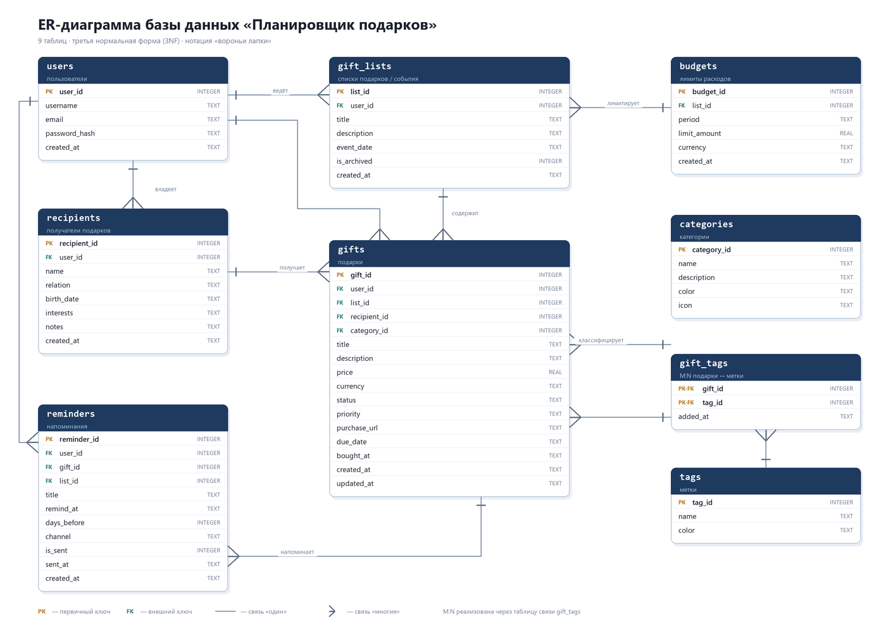
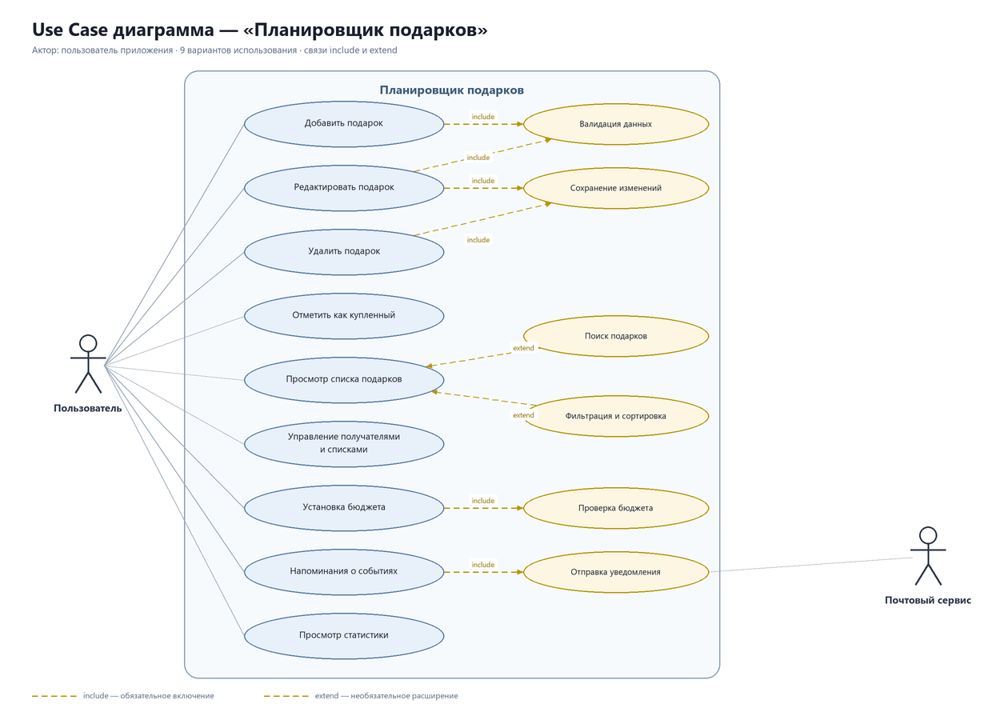

# Planirivhik-podarkov — Планировщик подарков 🎁

Веб-приложение для планирования подарков: списки подарков по получателям и
событиям, статусы («желаемый», «в корзине», «куплен», «подарен»), приоритеты,
бюджеты, напоминания о праздниках.

## Возможности

- добавление подарка с указанием получателя;
- отметка подарка как купленного и возврат в список ожидания;
- счётчики «всего / куплено» и фильтры «Все / Ожидают / Купленные»;
- удаление подарка;
- *(в разработке)* категории, метки, бюджеты и напоминания — см. дорожную карту
  в разделе [Issues](https://github.com/dimasutjrin-coder/Planirivhik-podarkov/issues).

## Структура репозитория

```text
.
├── index.html                  # интерфейс приложения
├── style.css                   # стили
├── script.js                   # логика списка подарков
├── database/
│   ├── schema.sql              # DDL: схема БД в 3NF, индексы, триггер, представления
│   ├── seed_data.sql           # тестовые данные
│   ├── normalization.md        # обоснование нормализации (1NF → 2NF → 3NF)
│   └── verify.py               # автопроверка схемы и тестовых данных
├── docs/
│   ├── database/
│   │   ├── er_diagram.png      # ER-диаграмма (изображение)
│   │   ├── er_diagram.svg      # ER-диаграмма (вектор)
│   │   └── er_diagram.puml     # исходник ER-диаграммы (PlantUML)
│   └── behavior/               # моделирование поведения (ЛР 5)
│       ├── README.md           # описание акторов, use case и сценариев
│       ├── use_case/           # Use Case диаграмма (PNG + PlantUML)
│       └── sequence/           # 4 диаграммы последовательности (PNG + PlantUML)
└── .github/workflows/ci.yml    # проверка HTML/CSS/JS и загрузки SQL-скриптов
```

## База данных

Схема спроектирована для SQLite и приведена к **третьей нормальной форме**.
Девять таблиц: `users`, `recipients`, `gift_lists`, `categories`, `tags`,
`gifts`, `gift_tags`, `budgets`, `reminders`.



- **ER-диаграмма:** [`docs/database/er_diagram.png`](docs/database/er_diagram.png)
  (вектор — [`er_diagram.svg`](docs/database/er_diagram.svg),
  исходник — [`er_diagram.puml`](docs/database/er_diagram.puml)).
- **DDL-скрипт:** [`database/schema.sql`](database/schema.sql) — таблицы,
  ограничения целостности, индексы, триггер `updated_at` и представления
  `v_gift_details`, `v_budget_usage`, `v_upcoming_events`.
- **Тестовые данные:** [`database/seed_data.sql`](database/seed_data.sql) —
  3 пользователя, 6 получателей, 5 списков, 12 подарков, метки, бюджеты и напоминания.
- **Документация по нормализации:** [`database/normalization.md`](database/normalization.md).

### Запуск и проверка БД

```bash
# создать локальную БД и загрузить данные
sqlite3 gifts.db < database/schema.sql
sqlite3 gifts.db < database/seed_data.sql

# проверить целостность и посмотреть бюджеты
sqlite3 gifts.db "PRAGMA integrity_check; PRAGMA foreign_key_check;"
sqlite3 -header -column gifts.db "SELECT * FROM v_budget_usage;"

# автоматическая проверка (Python 3)
python database/verify.py
```

### Ключевые решения модели

| Решение | Почему так |
|---|---|
| `gift_tags` с составным PK | связь M:N «подарок — метка» без дублирования меток в строке подарка |
| `recipients` и `gift_lists` отдельно от `gifts` | устранены частичные и транзитивные зависимости (2NF, 3NF) |
| `bought_at` заполняется только для `bought`/`given` | логический `CHECK` не даёт «подарить некупленное» |
| бюджеты и остатки не хранятся в таблицах | считаются представлением `v_budget_usage` из `gifts` |
| индексы по всем FK и полям фильтров | фильтры по категории, статусу, получателю и датам работают без полного сканирования |

## Моделирование поведения (ЛР 5)

Use Case диаграмма и четыре диаграммы последовательности с описанием сценариев —
в [`docs/behavior/README.md`](docs/behavior/README.md).



## Запуск приложения

Открыть `index.html` в браузере — приложение статическое, сборка не требуется.

## Дорожная карта

Задачи ведутся в [Issues](https://github.com/dimasutjrin-coder/Planirivhik-podarkov/issues)
и сгруппированы по milestone: базовый функционал, организация и умные функции,
финальное тестирование и релиз v1.0.
