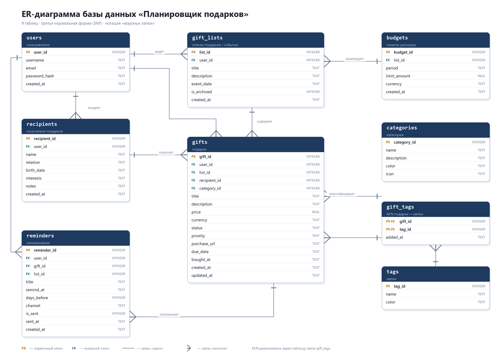

# Процесс проектирования и нормализации базы данных

Документ описывает, как требования приложения **«Планировщик подарков»** превращены
в реляционную схему, приведённую к **третьей нормальной форме (3NF)**.

Связанные файлы:

| Файл | Назначение |
|---|---|
| [`database/schema.sql`](schema.sql) | DDL-скрипт: таблицы, ограничения, индексы, триггер, представления |
| [`database/seed_data.sql`](seed_data.sql) | Тестовые данные (пользователи, получатели, подарки, бюджеты, напоминания) |
| [`docs/database/er_diagram.png`](../docs/database/er_diagram.png) | ER-диаграмма (PNG) |
| [`docs/database/er_diagram.puml`](../docs/database/er_diagram.puml) | Исходник ER-диаграммы (PlantUML) |
| [`database/verify.py`](verify.py) | Автопроверка: загрузка схемы и данных, инварианты, тестовые выборки |

---

## 1. Исходная (денормализованная) структура

Чтобы увидеть, зачем нужна нормализация, представим «наивное» решение: всё
приложение хранит данные в одной таблице, как это делает текущая версия
фронтенда (`index.html` + `script.js` — подарок и получатель лежат в одной
строке списка):

```text
Gifts_Flat (
    gift_id,
    title,                 -- название подарка
    recipient_id,
    recipient_name,        -- имя получателя, дублируется в каждой строке
    recipient_birth_date,  -- дата рождения, дублируется
    category_name,         -- категория строкой: «Книги, Техника»
    tags,                  -- метки строкой: «handmade, до 1000 ₽»
    list_title,            -- название списка, дублируется
    price,
    status,
    priority
)
```

Проблемы такой структуры:

* **Избыточность.** Имя, дата рождения получателя и название списка
  повторяются в каждой строке подарка. Чем больше подарков, тем больше копий.
* **Аномалия обновления.** Если у получателя изменилась дата рождения, придётся
  обновить все его подарки. Забыли одну строку — в базе два разных значения.
* **Аномалия удаления.** Удалив последний подарок получателя, мы теряем всю
  информацию о нём (имя, дату рождения, интересы).
* **Аномалия вставки.** Нельзя добавить нового получателя, пока для него нет
  хотя бы одного подарка.
* **Нарушение 1NF.** В полях `category_name` и `tags` хранятся списки значений
  через запятую — атрибуты не атомарны.

---

## 2. Нормализация до 1NF (первая нормальная форма)

**Требование:** все атрибуты атомарны, в таблице нет повторяющихся групп.

**Что было не так:** `category_name = 'Книги, Техника'` и `tags = 'handmade,
до 1000 ₽'` — это несколько значений в одной ячейке. По таким данным нельзя
построить индекс, нельзя корректно отфильтровать «все подарки категории Книги».

**Что сделали:**

1. Категорию вынесли в справочник `categories`, в `gifts` остался только
   внешний ключ `category_id`.
2. Метки вынесли в справочник `tags`. Так как у одного подарка может быть
   несколько меток, а одна метка — у многих подарков, связь **M:N** реализована
   таблицей связи `gift_tags (gift_id, tag_id)` с составным первичным ключом.
3. Получателей и списки подарков вынесли в отдельные таблицы
   `recipients` и `gift_lists`.

**Результат:** каждая ячейка содержит одно значение; появились первичные ключи
(`gift_id`, `category_id`, `tag_id`, ...) и внешние ключи на них.

---

## 3. Нормализация до 2NF (вторая нормальная форма)

**Требование:** каждый неключевой атрибут зависит от *всего* первичного ключа
(устраняются частичные зависимости).

**Что было не так:** в плоской таблице `Gifts_Flat` поля `recipient_name`,
`recipient_birth_date` зависят только от `recipient_id`, но не от `gift_id`.
Это частичная зависимость от части составного ключа.

**Что сделали:**

* Данные получателей вынесли в `recipients (recipient_id, user_id, name,
  relation, birth_date, interests, notes, created_at)`, а в `gifts` оставили
  только `recipient_id`.
* Аналогично поступили с пользователями (`users`) и списками (`gift_lists`):
  в `gifts` остались только `user_id` и `list_id`.
* В таблице связи `gift_tags` неключевых атрибутов почти нет, кроме `added_at`,
  который зависит от всей пары `(gift_id, tag_id)` — то есть от ключа целиком.

**Результат:** каждый неключевой атрибут зависит от полного первичного ключа
своей таблицы. Данные получателя хранятся в одном месте.

---

## 4. Нормализация до 3NF (третья нормальная форма)

**Требование:** нет транзитивных зависимостей — неключевые атрибуты не зависят
друг от друга.

**Что было не так (пример транзитивной зависимости):** если оставить в `gifts`
поле `category_name`, то `category_name` зависит от `category_id`, а `category_id`
— от `gift_id`. Значит, `category_name` зависит от `gift_id` *транзитивно*:
переименование категории потребовало бы правки всех подарков.

**Что сделали:**

1. Убрали `category_name` из `gifts` — название категории живёт только в
   `categories.name`.
2. Убрали `recipient_name` / `recipient_birth_date` из `gifts` — они живут в
   `recipients`.
3. **Не стали хранить вычисляемые величины.** Остаток бюджета, количество
   купленных подарков и стоимость списка не хранятся в таблицах: они считаются
   представлениями (`v_budget_usage`, `v_gift_details`) из первичных данных.
   Хранение «потрачено = 2200» рядом с подарками нарушило бы 3NF (зависимость
   `spent` от набора строк `gifts`) и создало бы аномалию обновления при
   изменении цены подарка.
4. Служебная метка `updated_at` поддерживается **триггером** `trg_gifts_updated_at`,
   а не приложением, — единственный источник истины для времени изменения.

**Результат:** все неключевые атрибуты зависят только от первичного ключа
своей таблицы; изменение названия категории или даты рождения получателя
требует ровно одного `UPDATE`.

---

## 5. Реализация связей «многие-ко-многим» (M:N)

В реляционной БД нельзя напрямую связать подарок и метку так, чтобы у подарка
было много меток, а у метки — много подарков. Используется промежуточная
таблица:

```sql
CREATE TABLE gift_tags (
    gift_id  INTEGER NOT NULL,
    tag_id   INTEGER NOT NULL,
    added_at TEXT    NOT NULL DEFAULT (datetime('now')),
    PRIMARY KEY (gift_id, tag_id),
    FOREIGN KEY (gift_id) REFERENCES gifts (gift_id) ON DELETE CASCADE,
    FOREIGN KEY (tag_id)  REFERENCES tags  (tag_id)  ON DELETE CASCADE
);
```

Составной первичный ключ `(gift_id, tag_id)` одновременно:

* запрещает дубликаты пары «подарок — метка»;
* служит индексом для прямого поиска меток подарка;
* `ON DELETE CASCADE` автоматически чистит связи при удалении подарка или метки.

Обратный поиск («все подарки с меткой *идея*») обеспечивает
`idx_gift_tags_tag_id`.

---

## 6. Финальная схема

| Таблица | Первичный ключ | Назначение |
|---|---|---|
| `users` | `user_id` | Владелец аккаунта; все данные изолированы по `user_id` |
| `recipients` | `recipient_id` | Получатель подарка: имя, отношение, дата рождения, интересы |
| `gift_lists` | `list_id` | Список подарков, привязанный к событию и дате |
| `categories` | `category_id` | Справочник категорий (книги, техника, ...) |
| `tags` | `tag_id` | Свободные метки |
| `gifts` | `gift_id` | Подарок: цена, статус, приоритет, срок, ссылка |
| `gift_tags` | `(gift_id, tag_id)` | Связь M:N «подарок — метка» |
| `budgets` | `budget_id` | Лимит расходов на список за месяц |
| `reminders` | `reminder_id` | Напоминание о подарке или событии |

ER-диаграмма: 

### Связи между таблицами

| Связь | Кардинальность | Правило удаления |
|---|---|---|
| `users` → `recipients` | 1:N | `CASCADE` (удалили аккаунт — удалились получатели) |
| `users` → `gift_lists` | 1:N | `CASCADE` |
| `users` → `gifts` | 1:N | `CASCADE` |
| `gift_lists` → `gifts` | 1:N | `SET NULL` (подарок остаётся в общем списке) |
| `recipients` → `gifts` | 1:N | `SET NULL` |
| `categories` → `gifts` | 1:N | `SET NULL` |
| `gifts` ↔ `tags` | M:N через `gift_tags` | `CASCADE` |
| `gift_lists` → `budgets` | 1:N | `CASCADE` |
| `gifts` / `gift_lists` → `reminders` | 1:N | `CASCADE` |

### Целостность данных на уровне БД

Схема защищает данные не только «на бумаге», но и ограничениями:

* `UNIQUE` — `users.email`, `users.username`, `categories.name`,
  `recipients(user_id, name)`, `gift_lists(user_id, title)`,
  `budgets(list_id, period)`;
* `tags.name` объявлен как `COLLATE NOCASE UNIQUE`: регистр не важен для
  латинских меток (`handmade` = `HandMade`). Кириллицу SQLite без ICU не
  сворачивает, поэтому приложение приводит названия меток к нижнему регистру
  перед сохранением;
* `CHECK` — допустимые статусы (`desired`, `in_cart`, `bought`, `given`) и
  приоритеты (`low`, `medium`, `high`), `price >= 0`, формат дат `YYYY-MM-DD`,
  формат периода `YYYY-MM`, валюта из 3 заглавных букв;
* **логические** `CHECK`:
  * `bought_at IS NULL OR status IN ('bought','given')` — дата покупки только
    у купленного/подаренного;
  * `status <> 'given' OR bought_at IS NOT NULL` — нельзя «подарить» то, что не
    куплено;
  * `gift_id IS NOT NULL OR list_id IS NOT NULL` — напоминание всегда к чему-то
    привязано;
  * `(is_sent = 0 AND sent_at IS NULL) OR (is_sent = 1 AND sent_at IS NOT NULL)` —
    состояние отправки согласовано.

---

## 7. Индексы и зачем они нужны

Внешние ключи в SQLite **не индексируются автоматически**, поэтому в
`schema.sql` явно созданы индексы по всем FK-столбцам и по полям фильтрации:

| Индекс | Запрос, который он ускоряет |
|---|---|
| `idx_gifts_user_id` | «все мои подарки» |
| `idx_gifts_user_status` | «мои неподаренные подарки» (составной) |
| `idx_gifts_status`, `idx_gifts_priority` | фильтры и сортировка по статусу/приоритету |
| `idx_gifts_due_date` | ближайшие сроки вручения |
| `idx_gifts_list_id`, `idx_gifts_recipient_id`, `idx_gifts_category_id` | фильтры по списку / получателю / категории |
| `idx_gift_tags_tag_id` | обратный поиск «подарки с меткой» |
| `idx_reminders_remind_at` | планировщик: «что отправить в ближайший час» |
| `idx_lists_event_date` | блок «Скоро праздник» |

---

## 8. Как проверить схему

```bash
# 1. Создать БД и загрузить данные
sqlite3 gifts.db < database/schema.sql
sqlite3 gifts.db < database/seed_data.sql

# 2. Проверить целостность
sqlite3 gifts.db "PRAGMA integrity_check; PRAGMA foreign_key_check;"

# 3. Посмотреть исполнение бюджета
sqlite3 -header -column gifts.db "SELECT * FROM v_budget_usage;"

# 4. Автоматическая проверка (Python 3)
python database/verify.py
```

Онлайн-песочницы для ручной проверки запросов:
<https://sqliteonline.com/> и <https://sqleditor.online.ru/>.

---

## 9. Примеры запросов приложения

```sql
-- Подарки пользователя с получателем и категорией (фильтр «желаемые, высокий приоритет»)
SELECT title, recipient_name, category_name, price, priority
  FROM v_gift_details
 WHERE status = 'desired'
 ORDER BY CASE priority WHEN 'high' THEN 1 WHEN 'medium' THEN 2 ELSE 3 END, price DESC;

-- Поиск и комбинированный фильтр (issue #22)
SELECT g.title, r.name AS recipient, c.name AS category
  FROM gifts g
  LEFT JOIN recipients r ON r.recipient_id = g.recipient_id
  LEFT JOIN categories c ON c.category_id  = g.category_id
 WHERE g.user_id = 1
   AND g.title LIKE '%набор%'
   AND g.status = 'desired'
   AND r.name = 'Мама';

-- Перерасход бюджета
SELECT list_title, limit_amount, spent, remaining
  FROM v_budget_usage
 WHERE remaining < 0;

-- Напоминания, которые пора отправить
SELECT title, remind_at, channel
  FROM reminders
 WHERE is_sent = 0 AND remind_at <= datetime('now')
 ORDER BY remind_at;
```

---

## 10. Что осталось за рамками (осознанные решения)

* **История статусов** (`gift_status_history`) не добавлена: она не требуется
  текущим ТЗ, но полезна для аналитики и может быть добавлена отдельной таблицей
  без изменения существующих.
* **Хранение денег во `REAL`** выбрано для читаемости учебной схемы. В продакшене
  сумму хранят в минорных единицах (`price_cents INTEGER`), чтобы избежать
  ошибок округления.
* **Изоляция данных по пользователю** обеспечивается внешними ключами на
  `users`, а сквозная проверка «получатель принадлежит тому же пользователю,
  что и подарок» выполняется на уровне приложения (SQLite не поддерживает
  составные FK с `ON DELETE SET NULL` без потери `user_id`).
