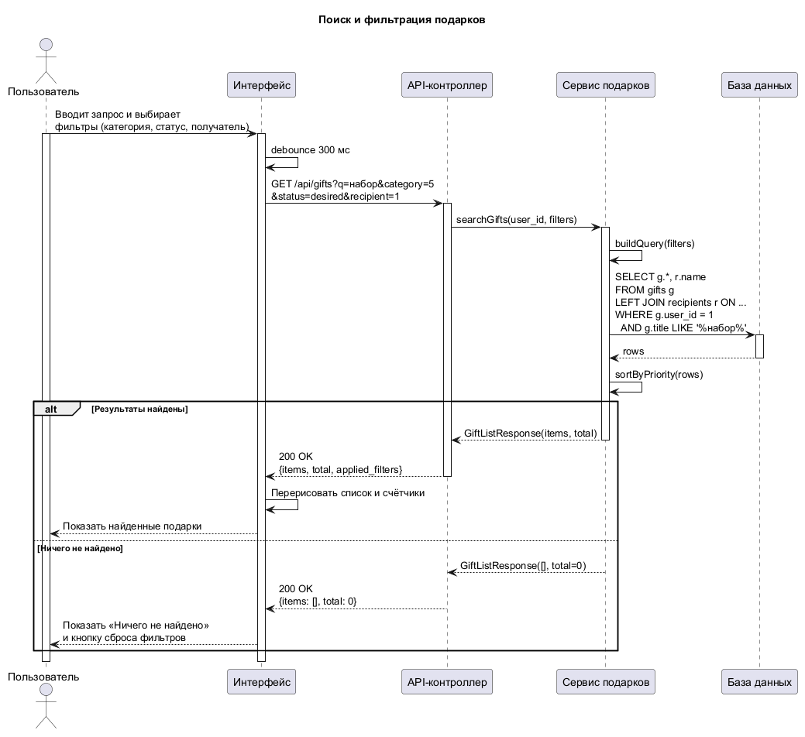

# Диаграммы поведения системы

Документация к лабораторной работе 5 «Моделирование поведения» для приложения
**«Планировщик подарков»**.

Все изображения в этом разделе получены из PlantUML-исходников (`.puml`) —
картинки и код всегда согласованы. Перегенерация:

```bash
plantuml -charset UTF-8 -tpng docs/behavior/use_case/use_case_diagram.puml
plantuml -charset UTF-8 -tpng docs/behavior/sequence/*.puml
```

## Use Case диаграмма

Описывает основные сценарии использования приложения «Планировщик подарков»
с точки зрения пользователя.


### Акторы

- **Пользователь** — основной пользователь системы: ведёт получателей, списки
  подарков, бюджеты и напоминания.
- **Почтовый сервис** — внешняя система, доставляющая email-напоминания (SMTP).

### Основные Use Cases

- Добавление подарка
- Редактирование подарка
- Удаление подарка
- Пометка подарка как купленного
- Просмотр списка подарков
- Управление получателями и списками
- Установка бюджета
- Напоминания о событиях
- Просмотр статистики

### Связи include / extend

- `include`: добавление и редактирование подарка включают **валидацию данных**;
  редактирование и удаление — **сохранение изменений**; установка бюджета —
  **проверку бюджета**; напоминания — **отправку уведомления**.
- `extend`: **поиск** и **фильтрация с сортировкой** расширяют просмотр списка.

Файлы: [`use_case/use_case_diagram.png`](use_case/use_case_diagram.png),
[`use_case/use_case_diagram.puml`](use_case/use_case_diagram.puml).

## Диаграммы последовательности

### 1. Добавление подарка

Показывает процесс создания нового подарка с валидацией данных, проверкой
остатка бюджета и обновлением интерфейса.


### 2. Отметка выполнения (куплен)

Демонстрирует изменение статуса подарка, фиксацию даты покупки и обновление
интерфейса; при закрытии всех подарков списка отправляется уведомление.


### 3. Поиск и фильтрация

Отображает механизм выборки подарков по запросу и комбинации фильтров:
категория, статус, получатель.



### 4. Напоминания о событиях

Комплексный сценарий фоновой обработки: планировщик выбирает неотправленные
напоминания, определяет канал (email / in-app) и отмечает факт отправки.


Файлы находятся в [`docs/behavior/sequence/`](sequence/).

## Связь с моделью данных

Сценарии опираются на таблицы из
[`database/schema.sql`](../../database/schema.sql):
`gifts`, `recipients`, `gift_lists`, `budgets`, `reminders`, а также на
представления `v_budget_usage` и `v_upcoming_events`.

## Используемые инструменты

- **PlantUML** — кодовое представление диаграмм (версионируется в Git);
- **draw.io** — визуальное редактирование (при необходимости).
