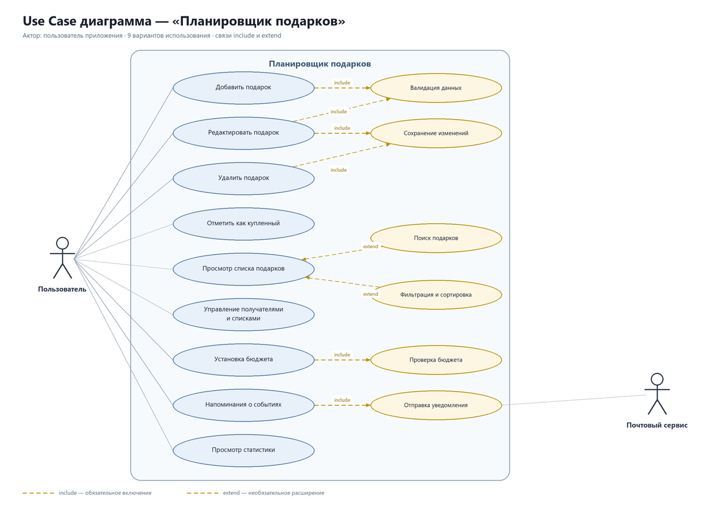
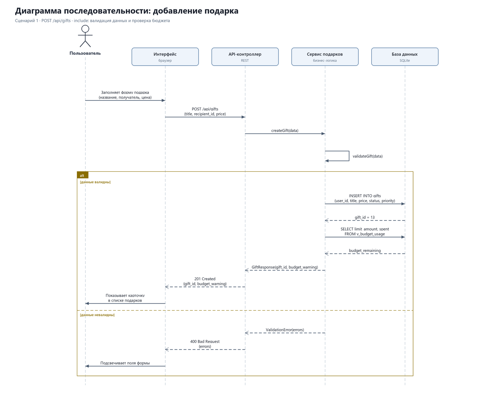
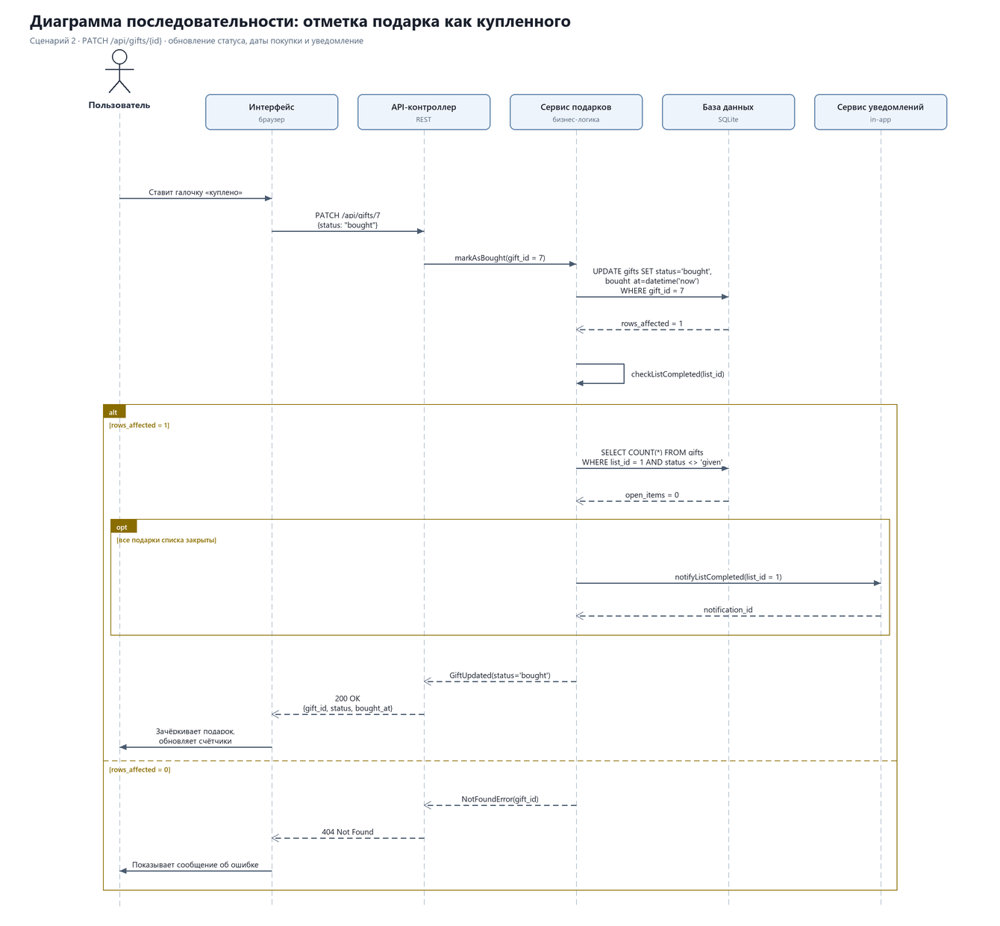
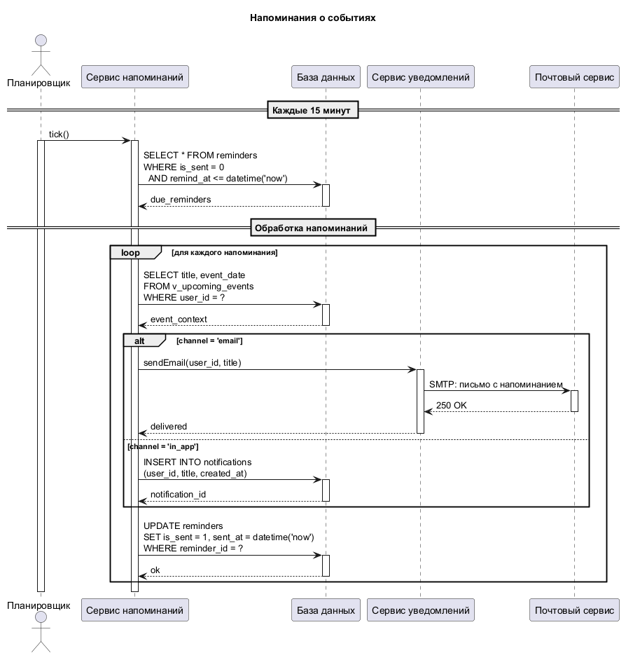

# Диаграммы поведения системы

Документация к лабораторной работе 5 «Моделирование поведения: Use Case и диаграммы
последовательности» для приложения **«Планировщик подарков»**.

Моделирование поведения опирается на структуру данных из
[`database/normalization.md`](../../database/normalization.md): все объекты,
участвующие в сценариях (`gifts`, `recipients`, `gift_lists`, `reminders`,
`budgets`), уже описаны в схеме БД.

## Содержание

| Артефакт | Файл |
|---|---|
| Use Case диаграмма (PNG) | [`use_case/use_case_diagram.png`](use_case/use_case_diagram.png) |
| Use Case диаграмма (исходник PlantUML) | [`use_case/use_case_diagram.puml`](use_case/use_case_diagram.puml) |
| Диаграмма последовательности: добавление подарка | [`sequence/add_gift_sequence.png`](sequence/add_gift_sequence.png) |
| Диаграмма последовательности: отметка «куплен» | [`sequence/complete_gift_sequence.png`](sequence/complete_gift_sequence.png) |
| Диаграмма последовательности: поиск и фильтрация | [`sequence/filter_gifts_sequence.png`](sequence/filter_gifts_sequence.png) |
| Диаграмма последовательности: напоминания о событиях | [`sequence/event_reminders_sequence.png`](sequence/event_reminders_sequence.png) |

Исходники всех диаграмм — в формате PlantUML (`.puml`), из них можно
перегенерировать PNG/SVG командой:

```bash
plantuml -tpng docs/behavior/use_case/use_case_diagram.puml
plantuml -tpng docs/behavior/sequence/*.puml
```

---

## 1. Use Case диаграмма



### Акторы

| Актор | Роль |
|---|---|
| **Пользователь** | Владелец списков подарков: создаёт получателей, списки, подарки, следит за бюджетом |
| **Почтовый сервис** | Внешняя система, доставляющая email-напоминания (SMTP) |

### Основные варианты использования

| Use Case | Что делает | Связанные требования |
|---|---|---|
| Добавить подарок | Создаёт подарок с названием, получателем, ценой, приоритетом | issue #14 |
| Редактировать подарок | Изменяет поля существующего подарка | issue #14 |
| Удалить подарок | Удаляет подарок из списка | issue #14 |
| Отметить как купленный | Меняет статус `desired → bought` и фиксирует дату покупки | issue #20 |
| Просмотр списка подарков | Показывает подарки пользователя со статусами и счётчиками | issue #13 |
| Управление получателями и списками | Ведёт справочник получателей и списки, привязанные к событиям | issue #16, #17 |
| Установка бюджета | Задаёт лимит расходов на список за месяц | issue #19 |
| Напоминания о событиях | Планирует напоминания за 7 / 3 / 1 день до события | issue #21 |
| Просмотр статистики | Показывает, сколько подарков куплено и сколько потрачено | issue #26 |

### Связи `include` и `extend`

| Связь | Тип | Смысл |
|---|---|---|
| Добавить подарок → Валидация данных | include | Подарок нельзя сохранить без проверки обязательных полей и цены |
| Редактировать подарок → Валидация данных | include | Те же правила проверки при изменении |
| Редактировать подарок → Сохранение изменений | include | Изменения фиксируются в БД и обновляют `updated_at` |
| Удалить подарок → Сохранение изменений | include | Удаление фиксируется в БД |
| Установка бюджета → Проверка бюджета | include | Лимит проверяется на пересечение с уже потраченными суммами |
| Напоминания о событиях → Отправка уведомления | include | Напоминание всегда доставляется (email или in-app) |
| Поиск подарков → Просмотр списка подарков | extend | Поиск — необязательное расширение просмотра |
| Фильтрация и сортировка → Просмотр списка подарков | extend | Фильтры применяются поверх того же списка |

Границы системы: всё, что находится внутри прямоугольника, реализует само
приложение; email-доставка вынесена за границу как внешний сервис.

---

## 2. Диаграммы последовательности

### 2.1. Добавление подарка



Показывает полный путь создания подарка: форма → `POST /api/gifts` → сервис →
валидация → `INSERT` в БД → проверка остатка бюджета через представление
`v_budget_usage` → ответ `201 Created`. Ветка `alt` демонстрирует обработку
невалидных данных: `400 Bad Request` и подсветку полей формы.

### 2.2. Отметка подарка как купленного



Сценарий `PATCH /api/gifts/{id}`: обновление `status` и `bought_at`, проверка
«все подарки списка закрыты?» и, если да, уведомление через
`notifyListCompleted()`. Ветка `rows_affected = 0` показывает обработку
несуществующего подарка (`404 Not Found`).

### 2.3. Поиск и фильтрация подарков


Комбинированный фильтр (`q`, `category`, `status`, `recipient`) превращается
в один SQL-запрос с `JOIN` на `recipients` и `categories`; результаты
сортируются по приоритету. Две ветки `alt` показывают, что интерфейс различает
«есть результаты» и «ничего не найдено».

### 2.4. Напоминания о событиях



Фоновый сценарий: планировщик раз в 15 минут вызывает `tick()`, сервис
выбирает неотправленные напоминания, для каждого определяет канал
(`email` / `in_app`), доставляет уведомление и помечает напоминание
отправленным (`is_sent = 1`, `sent_at`).

---

## 3. Как диаграммы связаны с кодом и БД

* Таблицы и ограничения, на которые опираются сценарии, — в
  [`database/schema.sql`](../../database/schema.sql).
* Представления `v_budget_usage` и `v_upcoming_events` используются
  в сценариях 1 и 4.
* Тестовые данные для ручной проверки сценариев — в
  [`database/seed_data.sql`](../../database/seed_data.sql).
* Проверка схемы и запросов: `python database/verify.py`.
